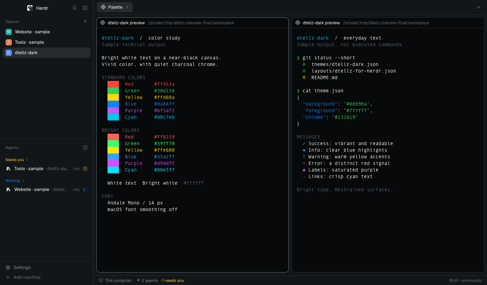

# dtellz-dark

A dark theme for [Herdr](https://herdr.dev/) with nearly black terminals, a charcoal interface, pure white main text, and vivid ANSI colors. Includes an optional copy of Herdr's standard layout so it can be installed from the gallery.



The screenshot shows labeled sample terminal output in a separate Herdr session, using Andale Mono 14 px with the optional macOS smoothing preference below.

## What's included

```text
themes/dtellz-dark.json             Color palette; works with other layouts
layouts/dtellz-for-herdr.json       Standard Herdr layout using dtellz-dark
layouts/dtellz-for-herdr.svg        Layout picker illustration
preview.png                       Gallery screenshot
RECIPE.md                         Brief for rebuilding the layout and theme
LICENSE                           Apache-2.0 license
NOTICE                            Attribution
```

The layout uses Herdr's built-in mods. There is no custom JavaScript, bundled font, or replacement key map. Theme and layout names are deliberately different: Herdr treats a theme with the same name as a layout as belonging only to that layout.

## Install

Use Herdr 0.1.13 or later with its standard mods installed. The release used to create this package was 0.1.13 on macOS. The theme and layout contain no macOS-only settings; the optional smoothing tweak below is macOS-only.

Run these commands from the repository root in a POSIX shell on macOS or Linux. They use `HERDR_APP_HOME` when set, otherwise `~/.config/herdr-app`. The copy helper accepts identical installed files and refuses to replace files with different contents.

```sh
dtellz_home="${HERDR_APP_HOME:-$HOME/.config/herdr-app}"
dtellz_copy() {
  if [ -e "$2" ] || [ -L "$2" ]; then
    if [ ! -L "$2" ] && cmp -s "$1" "$2"; then
      return 0
    fi
    printf 'Refusing to overwrite existing file: %s\n' "$2" >&2
    return 1
  fi
  mkdir -p "$(dirname "$2")" || return 1
  (set -C; cat "$1" > "$2")
}
```

### Just the colors

Keep your current layout and install the palette:

```sh
dtellz_copy themes/dtellz-dark.json "$dtellz_home/themes/dtellz-dark.json" &&
  HERDR_APP_HOME="$dtellz_home" herdr-app do app.theme --name dtellz-dark
```

Herdr must be running for the command. The theme is also available in **Settings → Look → Theme**. It is a dark theme: choose Dark appearance if your current appearance is Light. Existing theme selections and layout color overrides can affect what you see.

### Theme and gallery layout

Install the standard Herdr window with the theme selected:

```sh
dtellz_copy themes/dtellz-dark.json "$dtellz_home/themes/dtellz-dark.json" &&
  dtellz_copy layouts/dtellz-for-herdr.json "$dtellz_home/layouts/dtellz-for-herdr.json" &&
  dtellz_copy layouts/dtellz-for-herdr.svg "$dtellz_home/layouts/dtellz-for-herdr.svg" &&
  HERDR_APP_HOME="$dtellz_home" herdr-app do layout.switch --name dtellz-for-herdr
```

To return to Herdr's original layout:

```sh
HERDR_APP_HOME="$dtellz_home" herdr-app do layout.switch --name main
```

On Windows, copy the same files into the corresponding `themes` and `layouts` folders in your Herdr home, without replacing existing files, then use the same `herdr-app do` commands. No `settings.json`, saved sessions, personal paths, or app state files are needed.

## Font and macOS font smoothing

The layout inherits your terminal font, font size, and interface font. The reference look uses **Andale Mono at 14 px**, with zoom at 100%. You can select these in **Settings → Look**; no font files are included. If Andale Mono is unavailable, use an installed monospace font or Herdr's bundled JetBrains Mono.

For the reference look, we also disabled Herdr's extra macOS font stroke thickening. This is an app-specific native preference, separate from the color theme. Installing the theme does not change it.

First, record the current value:

```sh
defaults read dev.herdr.app AppleFontSmoothing
```

If macOS reports that the key does not exist, it was unset. To turn the extra smoothing off for Herdr:

```sh
defaults write dev.herdr.app AppleFontSmoothing -int 0
```

**Fully quit and reopen Herdr.** The renderer caches this preference for the process lifetime; switching themes or closing only a window is insufficient.

In the macOS renderer used by Herdr 0.1.13, this removes added stroke thickening while retaining antialiased edges. It applies to terminal and interface text in Herdr, not other applications. It is not a font-weight setting and does not guarantee identical rendering across fonts or displays.

To undo it **if the key was originally unset**:

```sh
defaults delete dev.herdr.app AppleFontSmoothing
```

If the key previously held an integer, restore that recorded value instead of deleting it. For example, only if the old value was `1`:

```sh
defaults write dev.herdr.app AppleFontSmoothing -int 1
```

Quit and reopen Herdr again after restoring the preference. The source implementation reads `AppleFontSmoothing` through `CFPreferencesCopyAppValue` and disables dilation only for numeric `0`; this native behavior may change in future Herdr versions.

## Color behavior

- Main terminal and interface text, ANSI white, and ANSI bright white are `#ffffff`.
- The terminal background is `#08090a`; surrounding chrome is `#131619`.
- Working, blocked, and done indicators use blue `#0a84ff`, yellow `#ffd60a`, and green `#30d158`.
- The theme controls the first 16 ANSI colors. Applications can supply their own RGB colors or use the remaining 256-color palette entries, which this theme does not replace.
- Applications can also request faint text. Secondary interface labels deliberately use muted gray. Neither behavior is a font-smoothing problem.

## Share through the Herdr gallery

Publish this folder as a public GitHub repository and add the repository topic **`herdr-layout`**. Keep `RECIPE.md`, `preview.png`, `layouts/`, and `themes/` in the repository. Herdr's [gallery instructions](https://herdr.dev/gallery/) say eligible repositories are discovered within an hour; community pictures are screened before appearing.

The repository can also be shared directly for people who only want `themes/dtellz-dark.json`. The gallery route uses the included layout. No GitHub remote or public repository is required for local use.

## Credits and license

The layout is derived from Herdr's `main` layout in version 0.1.13, distributed under Apache-2.0. It retains the standard interface and references the mods supplied by Herdr. The palette began with a Rex screenshot as a visual reference and was customized with pure white text and more saturated colors; this is an independent theme, not an official Rex package.

See [LICENSE](LICENSE) and [NOTICE](NOTICE) for licensing and attribution.
