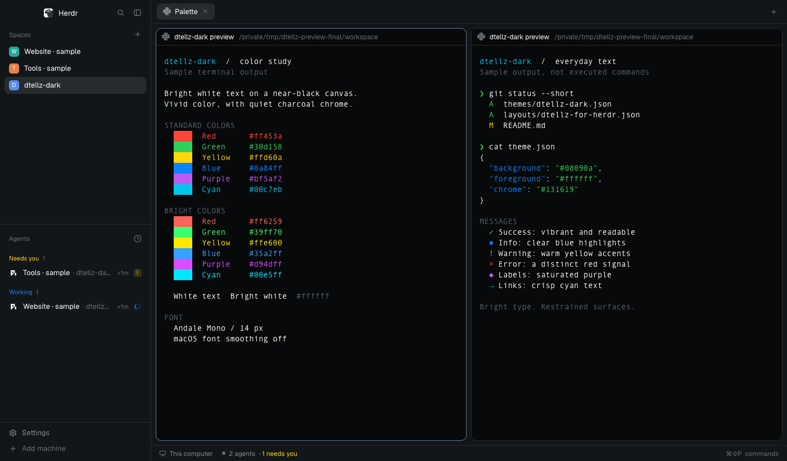

# dtellz-dark

A nearly black terminal workspace with bright white main text, vivid syntax colors, and quiet charcoal surroundings. The familiar Herdr window stays intact: spaces and agents on the left, tabs and terminal cards in the center, optional Files or Changes on the right, and a compact status bar below.



## What you see

At zoom 1, the left sidebar starts at 268 px wide on `#131619`, with a 46 px brand row, flexible spaces and agents lists sharing the remaining height, and a 69 px Settings/Add machine footer. The sidebar permits 44–480 px widths; its compact rail is 76 px on macOS or 44 px elsewhere. The expanded lists show names, program icons, status, and contextual details.

To the right, a 42 px tab bar holds 29 px rounded tab pills, a plus menu, and Files/Changes toggles when those built-in panels are enabled. The center has 8 px outer padding and gaps. Terminal cards use `#08090a`, 10 px corners, a 1 px `#262b2f` border, and a `#627b8e` focus border. Even a lone pane is framed. Every pane has an always-visible 30 px header, and terminal text has 14 px vertical and 12 px horizontal padding.

The optional right panel begins hidden, is 368 px wide, and can range from 280 to 900 px. A 28 px status strip spans the bottom of the work area. The system titlebar is hidden; on macOS the traffic lights sit at `[12, 16]`.

Main text is `#ffffff`. Secondary text is `#84898e`; quieter labels are `#656c72`. Selected rows and raised tabs are `#272b2e`, hover fills are `#1e2225`, popovers are `#1c2023`, and terminal selections are `#293746`. The cursor is blue `#0a84ff`. Fonts and zoom come from the person's settings; the reference uses Andale Mono 14 px at zoom 1, with the interface font inherited.

The 16 terminal colors, in ANSI index order, are:

```text
0  #3b4148    1  #ff453a    2  #30d158    3  #ffd60a
4  #0a84ff    5  #bf5af2    6  #00c7eb    7  #ffffff
8  #5a6069    9  #ff6259   10  #39ff70   11  #ffe600
12 #35a2ff   13  #d94dff   14  #00e5ff   15  #ffffff
```

## How it behaves

Agent status keeps Herdr's standard meaning and ordering: blocked, done, working, idle. Working uses a blue `#0a84ff` spinner; blocked uses yellow `#ffd60a` with a “Needs you” label or compact exclamation mark; done uses a green `#30d158` dot; idle uses a gray `#656c72` outline ring in the agent list. A pane header shows working, blocked, and done indicators, but no idle badge. The standard agent list can group by priority or space, pin agents, and fold groups or subagents. Selecting an agent brings its pane into view; looking at a finished agent acknowledges its done state.

Click a space or tab to select it. Drag spaces within their machine group to reorder them. Tabs can be dragged to reorder, double-clicked to rename, or right-clicked for their standard menu. The plus button offers a terminal or an installed agent. Hovering a pane header reveals split-right, split-down, zoom, and close controls. Split pane grips support dragging as in Herdr; the layout adds no custom drag behavior.

Files and Changes buttons open or close the right panel, remembering the choice per space through the shipped tabs mod. The sidebar toggle folds the left side to its rail. The brand row and tab bar allow moving the window. Settings, the picker, and the command palette use their normal controls. The layout defines no new keyboard bindings: the person's existing Herdr keys continue to apply, including whatever keys they have assigned to changing layouts, splitting panes, and opening the palette. Hovers use the neutral fills above; only the built-in working spinner animates as a status treatment.

## Built from

Create `themes/dtellz-dark.json` with `background`, `foreground`, `selection`, `cursor`, a 16-item `ansi` array, and a `colors` object. Set both the terminal foreground and `colors.foreground` to white. Fill the remaining color roles from the supplied theme, including status colors, `solid: #32383d`, `solid_foreground: #c8cdd2`, `ring: #7e8286`, and `input: #323638`.

Create `layouts/dtellz-for-herdr.json` as a copy of Herdr 0.1.13's `main` layout with root `theme: "dtellz-dark"`, `preview: "layouts/dtellz-for-herdr.svg"`, and `cloned_from: {"name":"main","version":"0.1.13"}`. The tree is:

```text
root (row)
├── sidebar (column)
│   ├── brand → workspace-chrome
│   ├── sidebar-lists (column)
│   │   ├── spaces → spaces
│   │   └── agents → agents
│   └── sidebar-footer → workspace-chrome {footer: true}
└── work (column)
    ├── tabs → tabs
    ├── work-body (row)
    │   ├── main → active tab, pane headers → pane
    │   └── panel (hidden column)
    │       └── panel-body (stack, initially files)
    │           ├── files → files
    │           └── changes → changes
    └── status → workspace-status
```

Retain every node ID: the shipped mods target `sidebar`, `panel`, and `panel-body`. The root has a 1 px border-colored divider. Sidebar and work columns set `resizable: false`; other default resizing behavior remains intact. Use `background: "canvas"` at the root and `"chrome"` on the sidebar. The palette sets both to `#131619`.

Reuse Herdr's shipped `workspace-chrome`, `spaces`, `agents`, `tabs`, `pane`, `files`, `changes`, and `workspace-status`; do not copy or modify their JavaScript. The footer's sole custom prop is `{footer: true}`. Herdr supplies `pane` and `terminal` props to each pane header. The stock controls also open built-in `new-menu`, `menu`, `picker`, and machine/settings interfaces.

These existing mods read `spaces()`, `agents()`, `terminals()`, `panes()`, `focused()`, `theme()`, `layout()`, `settings()`, `window()`, and shared state. They route actions through standard commands such as `space.select`, `space.move`, `space.new`, `tab.select`, `tab.move`, `tab.rename`, `tab.close`, `pane.focus`, `pane.split`, `pane.zoom`, `pane.close`, `terminal.pin`, `layout.resize`, `layout.select`, `layout.show`, `layout.hide`, `app.settings`, and `app.palette`. The agent list sets `setAgentOrder()`. Built-in Files and Changes inspect the active workspace with file reads and shell/Git commands; Spaces uses core machine information and Git metadata. The package adds no network requests, executable scripts, or custom mod runtime.

Draw the small SVG layout-picker illustration at `layouts/dtellz-for-herdr.svg`, using the actual theme colors and window regions. Capture `preview.png` from Herdr with harmless demonstration content. The recipe and gallery screenshot stay in the repository; only theme, layout, and layout-picker art are installed.

## Watch out

Theme and layout names must differ. A theme named exactly like a layout is only offered with that layout in Herdr's picker. Keep the theme reusable as `dtellz-dark`, and call the layout `dtellz-for-herdr`.

The theme controls ANSI slots 0–15. Program-specified RGB, other 256-color slots, and faint text can retain their own appearance. Do not raise `minimum_contrast` to imitate saturation: it replaces low-contrast colors rather than enriching them. Use a dark selection fill because Herdr does not expose a separate selection foreground in this theme format.

The layout inherits fonts; Andale Mono is not bundled and may be absent on other systems. The native macOS smoothing preference is also separate. The README documents `defaults write dev.herdr.app AppleFontSmoothing -int 0`, a full quit/reopen, and how to restore the previous preference. This removes extra stroke thickening in the renderer used by Herdr 0.1.13 while retaining antialiasing. Never apply it automatically during theme installation.

This is a copy of the layout structure, so future changes to Herdr's `main` layout do not merge into it. Its built-in mod references continue to use the installed Herdr versions. Existing panel preferences, sidebar state, theme-picker overrides, and the person's keys can change what is shown. Files/Changes buttons can be disabled in the person's workspace preferences. No extra control is intentionally decorative or unimplemented; behavior belongs to the installed stock mods.

Install alongside existing files, with a collision check; never replace another person's theme, layout, settings, keys, or sessions. Do not ship `layouts/.state/`, `settings.json`, `view.json`, `shared.json`, or personal mod data. The package has no fixed space, tab, terminal, or machine IDs.

## Done when

1. The theme JSON parses, has exactly 16 valid ANSI colors, and the layout JSON has unique node IDs and references only installed built-in mods.
2. Selecting `dtellz-dark` on the standard layout changes the terminal background to `#08090a` and default text to white; the theme is also offered outside `dtellz-for-herdr`.
3. Selecting `dtellz-for-herdr` displays the described standard layout with its theme and a recognizable layout-picker preview.
4. A terminal color sample shows all 16 ANSI slots, vivid red/green/yellow/blue/magenta/cyan, and white in both white slots. Text remains visible over the selection color.
5. Spaces and tabs can be selected; a pane can be split, focused, zoomed, and restored; Files and Changes can be opened and closed when enabled.
6. The shipped agent indicators use blue for working, yellow for blocked, green for done, and gray for idle when those statuses occur.
7. `herdr-app status` reports no configuration errors after installation. Inspect a live `herdr-app shot` screenshot for clipping, missing icons, and unintended color overrides. If any custom mod is introduced while rebuilding, it must also pass `herdr-app check` and be exercised in the app.
8. The repository contains its recipe, actual screenshot, theme, layout, picker art, and README with optional font-smoothing instructions; installation does not change fonts, keys, or native preferences by itself.
